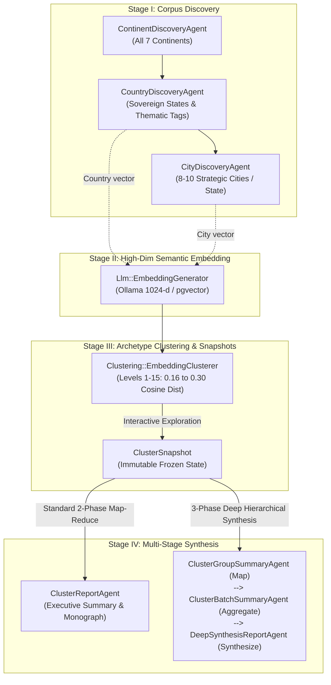

# Statesman: A Computational Laboratory for Comparative Geopolitics, Statecraft, and Urban Power Centers

[](https://www.ruby-lang.org/)
[](https://rubyonrails.org)
[](https://www.postgresql.org/)
[](https://github.com/pgvector/pgvector)
[](https://ollama.com)
[](https://github.com/flavorjones/ruby-llm)
[](https://sidekiq.org)
[](https://tailwindcss.com)
[](https://hotwired.dev)
[](LICENSE)

**Statesman** is an open-source computational research platform and quantitative analytical laboratory designed for **political scientists**, **international relations scholars**, **geostrategists**, and **urban economists**. It enables researchers to systematically map, cluster, and synthesize geopolitical archetypes, institutional trajectories, strategic geography, and urban power networks across world states and metropolitan centers using **1024-dimensional semantic vector embeddings (`pgvector`)**, **graph-theoretic connected components**, and **multi-stage AI synthesis pipelines**.

---

## Abstract & Scholarly Vision

For decades, comparative politics and international relations have grappled with a core methodological tension: how can scholars compare hundreds of sovereign states, developmental regimes, and key urban nodes across continents without either flattening institutional nuance or succumbing to impressionistic, case-study cherry-picking?

Classical institutional and geopolitical frameworks—such as **world-systems theory**, **varieties of capitalism**, **developmental statecraft**, **maritime vs. continental strategic geography**, and **global city hierarchy models**—offer rich theoretical lenses, yet empirical discovery across hundreds of states and thousands of urban hubs has traditionally been constrained by manual data synthesis.

**Statesman** operationalizes these comparative frameworks in a transparent, reproducible, locally hosted computational laboratory:

1. **Multi-Tier Corpus Construction**: Automated scholarly discovery agents populate a structured relational catalog of global **Continents**, sovereign **Countries (`Country`)**, thematic statecraft tags, and 8–10 strategically prominent **Cities (`City`)** per sovereign state.
2. **High-Dimensional Semantic Manifold**: Every sovereign state profile and urban center is projected into a **1024-dimensional vector space** indexed via PostgreSQL `pgvector` HNSW (`vector_cosine_ops`), enabling empirical measurement of semantic proximity across continents and regimes.
3. **Multi-Granularity Empirical Clustering & Snapshotting**: Researchers interactively tune cosine distance thresholds across **15 granularity levels** (from tight structural twins at *Level 1, $\le 0.16$* to zero-singleton **100% Full Catalog Coverage** at *Level 15* via a two-stage core-and-absorption algorithm that prevents single-linkage megacluster collapse) and freeze states into immutable **Cluster Snapshots**.
4. **Map-Reduce & Hierarchical Deep Synthesis Reports**: Rather than relying on shallow single-prompt summaries, Statesman executes a **2-Phase Map-Reduce** or **3-Phase Hierarchical Deep Synthesis** workflow over saved snapshots, inspecting every cluster through the researcher's specific inquiry and grounding every finding in cited cluster numbers, states, and cities.

---

## Table of Contents

1. [Research Tracks & Disciplinary Applications](#1-research-tracks--disciplinary-applications)
   - [For Comparative Political Scientists & IR Scholars](#11-for-comparative-political-scientists--ir-scholars)
   - [For Geostrategists & Urban Economists](#12-for-geostrategists--urban-economists)
2. [End-to-End Empirical Research Pipeline](#2-end-to-end-empirical-research-pipeline)
   - [Stage I: Multi-Tier Corpus Discovery (`/`, `/countries`, `/cities`)](#stage-i-multi-tier-corpus-discovery)
   - [Stage II: High-Dimensional Semantic Embedding (`/settings`)](#stage-ii-high-dimensional-semantic-embedding)
   - [Stage III: Interactive Archetype Clustering & Snapshots (`/clusters`, `/cluster_snapshots`)](#stage-iii-interactive-archetype-clustering--snapshots)
   - [Stage IV: Multi-Stage Scholarly Report Synthesis (`/reports`)](#stage-iv-multi-stage-scholarly-report-synthesis)
3. [Computational Methodology: Vector Clustering & Zero-Singleton Absorption](#3-computational-methodology-vector-clustering--zero-singleton-absorption)
   - [Vector Distance Metric & Pairwise SQL Filter](#31-vector-distance-metric--pairwise-sql-filter)
   - [Connected Components (Union-Find) & Heuristic Labeling](#32-connected-components-union-find--heuristic-labeling)
   - [Similarity Granularity Slider (Levels 1–15)](#33-similarity-granularity-slider-levels-115)
   - [Full Coverage & Zero-Singleton Mode (Nearest-Cluster Absorption)](#34-full-coverage--zero-singleton-mode-nearest-cluster-absorption)
   - [Programmatic Snapshot Persistence & ActiveRecord Queries](#35-programmatic-snapshot-persistence--activerecord-queries)
4. [Installation & Local Laboratory Setup](#4-installation--local-laboratory-setup)
5. [Programmatic REST API (`/api/v1`) & OpenAPI 3.1 Spec](#5-programmatic-rest-api-apiv1--openapi-31-spec)
6. [Open Science, Reproducibility, & Testing](#6-open-science-reproducibility--testing)

---

## 1. Research Tracks & Disciplinary Applications

Statesman runs 100% locally on your workstation using open-weights language and embedding models via Ollama and PostgreSQL `pgvector`. There are no proprietary API paywalls, rate limits, or opaque cloud mutations, making your empirical snapshots and synthesized monographs reproducible and auditable.

### 1.1 For Comparative Political Scientists & IR Scholars

Comparative politics and international relations examine how states configure political institutions, state capacity, resource rents, and international alliances:

- **Institutional Typologies & Developmental States**: Cluster states by bureaucratic autonomy, industrial policy, resource sovereign models, and welfare regimes to identify functional equivalents across different continental zones.
- **Cross-Continental Regime Counterparts**: Trace empirical affinities between developmental paths across Latin America, Southeast Asia, Sub-Saharan Africa, and Post-Soviet Eurasia.
- **Strategic Geography & Alignment**: Compare insular maritime democracies with continental land powers facing border security dilemmas.

> [!TIP]
> **Sample Geopolitical Research Inquiries (Copy & Paste into a Snapshot Report):**
> - *"Analyze how resource-rich sovereign states across clusters negotiate the transition toward industrial diversification and state-capitalist sovereign wealth funds. Which non-Gulf states exhibit the closest structural statecraft parallels?"*
> - *"Examine maritime trade gateway states across the clustered countries. Contrast insular trade dependencies with continental choke-point logistics hubs."*
> - *"Investigate institutional resilience and bureaucratic state capacity across post-colonial regimes in Africa, Asia, and Latin America. Where do developmental models converge?"*

### 1.2 For Geostrategists & Urban Economists

Urban geography and regional economics recognize that cities are the primary nodes of global capital flows, logistical networks, and political mobilization:

- **Metropolitan Power Centers & Functional Archetypes**: By clustering `City` vectors, researchers isolate financial capitals, deepwater port gateways, administrative command centers, and industrial corridors independently of national borders.
- **Primary Cities vs. Secondary Regional Anchors**: Analyze whether secondary manufacturing and maritime hubs (e.g., Busan, Rotterdam, Marseille, Surabaya) cluster closer to cross-border functional peers than to their own national capitals.
- **Choke-Point Logistics & Gateway Economics**: Observe how maritime canal nodes, deepwater straits, and pipeline junctions form specialized functional clusters across continents.

> [!TIP]
> **Sample Urban Statecraft Inquiries (Copy & Paste into a Snapshot Report):**
> - *"Compare primary commercial and maritime port cities across clusters. Which secondary port gateways in Southeast Asia and Europe share the highest structural affinity in logistics and petrochemical infrastructure?"*
> - *"Identify inland manufacturing and tech hubs that resist standard maritime gateway profiles. What regional economic architectures anchor their resilience?"*

---

## 2. End-to-End Empirical Research Pipeline

Statesman structures cross-continental investigation into a four-stage empirical pipeline:



### Stage I: Multi-Tier Corpus Discovery

1. **Continents (`/`)**: `ContinentDiscoveryAgent` populates all 7 standard continents (Africa, Antarctica, Asia, Europe, North America, Oceania, South America) with canonical geopolitical, institutional, and political-economic descriptions.
2. **Countries (`/countries`)**: `CountryDiscoveryAgent` discovers all sovereign states within each continent (Antarctica cleanly handled with 0 states), capturing governance structures, strategic geography, economic models, and thematic tags (e.g., `["semi-presidential republic", "maritime power", "nuclear energy"]`).
3. **Cities (`/cities`)**: `CityDiscoveryAgent` discovers 8–10 major, economically central, or strategically vital cities per country, capturing civic roles, economic bases, logistics gateways, and urban tags.

### Stage II: High-Dimensional Semantic Embedding

In `/settings`, trigger parallelized embedding workers using open-weights embedding models (e.g., `qwen3-embedding:0.6b` via Ollama) producing 1024-dimensional normalized vectors stored directly in PostgreSQL with `pgvector` HNSW indexes.

### Stage III: Interactive Archetype Clustering & Snapshots

In `/clusters`, navigate live clusterings of `Country` or `City` manifolds:
- Adjust similarity levels from **Level 1** (strict twins, $\le 0.16$ cosine distance) to **Level 15** (comprehensive absorption, $\le 0.30$).
- Toggle **Full Coverage** (zero-singleton mode) to absorb peripheral states into their nearest semantic cluster core.
- Click **Freeze Snapshot** to store an immutable `ClusterSnapshot` record with all group memberships.

### Stage IV: Multi-Stage Scholarly Report Synthesis

In `/cluster_snapshots/:id`, run analytical synthesis workflows:
- **Standard 2-Phase Map-Reduce**: Analyzes individual clusters through the researcher's prompt, then reduces them into a cohesive monograph citing cluster numbers and entities.
- **3-Phase Deep Hierarchical Synthesis**: Scales to hundreds of clusters without LLM context degradation by adding an intermediate batch aggregation layer.

---

## 3. Computational Methodology: Vector Clustering & Zero-Singleton Absorption

Statesman executes graph-theoretic connected component clustering on PostgreSQL `pgvector`:

```
Cosine Distance d(u, v) = 1 - (u · v) / (||u|| * ||v||)
```

1. **Pairwise SQL Threshold Filter**: Queries symmetric pairs with `d(a, b) <= threshold` using indexed cosine distance (`<=>`).
2. **Disjoint-Set Union-Find**: Constructs connected component subgraphs representing archetype cores.
3. **Two-Stage Nearest-Cluster Absorption (Levels 11–15)**: To achieve 100% catalog coverage without triggering single-linkage chaining (where high thresholds collapse the entire graph into a single megacluster), singletons are preserved at their strict distance threshold ($\le 0.25$) and absorbed individually into their single nearest multi-member cluster core.
4. **Heuristic Labeling**: Archetype titles and shared themes are generated using frequency-weighted stop-word filtered theme extraction.

---

## 4. Installation & Local Laboratory Setup

### Prerequisites

- **Ruby 3.4+** and **Rails 8.1+**
- **PostgreSQL 16+** with the `pgvector` extension enabled
- **Redis 7+** (for Sidekiq background jobs and ActionCable Turbo Streams)
- **Ollama** running locally with language and embedding models

### Setup Commands

```bash
# Clone and enter the repository
git clone https://github.com/leouofa/statesman.git
cd statesman

# Install Ruby gems
bundle install

# Setup database (creates statesman_development and statesman_test with pgvector)
bin/rails db:prepare

# Start local server and worker processes
bin/dev
```

### Pulling Ollama Models

```bash
# Language model for discovery and report synthesis
ollama pull Qwen3.6-35B-A3B-NVFP4

# 1024-dimensional embedding model
ollama pull qwen3-embedding:0.6b
```

---

## 5. Programmatic REST API (`/api/v1`) & OpenAPI 3.1 Spec

Statesman provides a complete, programmatic REST API under `/api/v1` along with an interactive **OpenAPI 3.1 specification** (`GET /api/v1/openapi.json`):

- **Continents**: Full CRUD, batch upsert, and LLM discovery (`/api/v1/continents`).
- **Countries**: CRUD, batch upsert, continent/theme filtering, semantic vector search, nearest-neighbor similarity (`/api/v1/countries/:id/neighbors`), and embedding generation.
- **Cities**: CRUD, country/theme filtering, semantic vector search, nearest-neighbor similarity (`/api/v1/cities/:id/neighbors`), and embedding generation.
- **Clusters & Snapshots**: Live clustering computation, snapshot creation, group and membership inspection (`/api/v1/clusters`, `/api/v1/cluster_snapshots`).
- **Archetype & Deep Synthesis Reports**: Triggering, tracking, and retrieving 2-phase and 3-phase detailed synthesis reports (`/api/v1/cluster_reports`).
- **Cross-Resource Search**: Hybrid semantic (`pgvector`) and keyword search across countries and cities (`/api/v1/search?q=...&mode=auto`).
- **Platform Status & Job Tracking**: Health check and asynchronous Sidekiq job monitoring (`/api/v1/status`, `/api/v1/jobs/:id`).

---

## 6. Open Science, Reproducibility, & Testing

Statesman is built with full test coverage across models, background jobs, LLM agents, clustering services, and REST controllers.

```bash
# Run the full test suite
bin/rails test

# Run RuboCop code style check
bin/rubocop
```

### Academic Citation

If you use Statesman to discover cross-continental statecraft archetypes or generate comparative geopolitical monographs, please cite:

```bibtex
@software{statesman2026,
  title   = {Statesman: A Computational Laboratory for Comparative Geopolitics, Statecraft, and Urban Power Centers},
  author  = {Statesman Contributors},
  url     = {https://github.com/leouofa/statesman},
  year    = {2026}
}
```

---

## License

This software is distributed under the **MIT License**.
